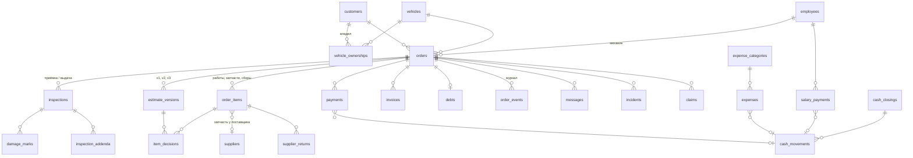

# 04 · Модель данных

> Версия 0.1 · 2026-11-06
> Какие данные храним, как они связаны и по каким правилам меняются. Названия таблиц и полей — на английском (так они будут в коде), пояснения — на русском.
> Это логическая модель: точные типы и индексы уточняются в миграциях на этапе разработки.

---

## 1. Общие правила

| Правило | Как |
|---|---|
| **Деньги** | целые числа в **филсах** (1 AED = 100 fils), поля с суффиксом `_fils`. Никаких дробных чисел для денег |
| **Цены** | храним **без VAT** (net). Если в настройках «цены вводятся с VAT», пересчитываем при вводе |
| **VAT** | ставка в базисных пунктах: `500` = 5 %. VAT считается по строке и округляется до филса, итог = сумма строк. Метод округления подтвердить с бухгалтером |
| **Время** | `timestamptz`, ставит **сервер** (`now()`), не телефон. Время с телефона храним отдельно (`device_*_at`) только для справки |
| **Часовой пояс** | показ — Asia/Dubai |
| **Идентификаторы** | UUID; человекочитаемые номера (заказ, инвойс) — отдельные поля из счётчиков |
| **Языки** | тексты для клиента храним в двух полях `*_ru` и `*_en` (хотя бы одно обязательно); документ берёт язык клиента, при отсутствии — второй |
| **Неизменяемость** | подписанные акты, отправленные версии оценки, решения клиента, выданные инвойсы и их файлы нельзя изменить или удалить — это запрещено на уровне базы данных. Исправления — только новой записью (дополнение, новая версия, кредит-нота) |
| **Удаление** | клиентов, машины, поставщиков — только архивируем (`archived_at`). Финансовые записи не удаляются никогда. Заказ без документов и денег можно удалить целиком (раздел 4.3) |
| **Журнал** | любое изменение важных таблиц пишется в `audit_log` (кто, когда, было, стало) |
| **Хэши** | у каждого фото и PDF храним SHA-256 — доказательство, что файл не подменён |

---

## 2. Схема связей (основное)



Фото, видео, подписи и PDF хранятся в одной таблице `media` и привязываются к любой сущности через `owner_type` + `owner_id`.
Ссылки для клиента — таблица `public_links`, ведут на конкретный документ.

---

## 3. Сущности

### 3.1. Настройки и пользователи

**`business_settings`** — одна запись, настройки мастерской.

| Поле | Описание |
|---|---|
| `name`, `address`, `phone`, `email` | реквизиты |
| `trn` | налоговый номер (TRN) |
| `logo_media_id` | логотип |
| `bank_details` | реквизиты для перевода |
| `google_maps_url` | ссылка для отзывов |
| `vat_rate_bp` | ставка VAT, по умолчанию 500 |
| `prices_include_vat` | цены вводятся с VAT или без |
| `default_markup_bp` | наценка на запчасти по умолчанию |
| `labor_rate_fils` | стоимость нормо-часа |
| `default_no_call_limit_fils` | лимит без звонка по умолчанию |
| `prepayment_threshold_fils` | порог, с которого просим предоплату за запчасть под заказ |
| `estimate_validity_days` | срок действия оценки (7) |
| `free_storage_days`, `storage_fee_per_day_fils` | стоянка после готовности |
| `diagnostics_fee_fils` | стоимость диагностики |
| `warranty_labor_months`, `warranty_labor_km` | гарантия на работы |
| `doc_texts` | тексты документов RU/EN (условия приёмки, гарантия, подвал) — JSON |
| `board_thresholds` | через сколько часов/дней подсвечивать флажки — JSON |
| `timezone` | Asia/Dubai |

**`profiles`** — пользователи приложения (связаны с учётной записью входа).

| Поле | Описание |
|---|---|
| `user_id` | учётная запись |
| `name` | имя |
| `role` | `manager` · `owner` · `mechanic` |
| `ui_language` | `ru` · `en` |
| `employee_id` | связь с сотрудником (для механика, v2) |

**`employees`** — сотрудники (механики могут не иметь входа в приложение).

| Поле | Описание |
|---|---|
| `name`, `phone` | |
| `role` | `mechanic` · `electrician` · `other` |
| `monthly_salary_fils` | фиксированный оклад |
| `active` | работает ли сейчас |

### 3.2. Клиенты и машины

**`customers`**

| Поле | Описание |
|---|---|
| `name` | имя или контактное лицо |
| `phone` | в формате E.164 (+9715…) |
| `whatsapp_phone` | если отличается от основного |
| `telegram` | номер или username |
| `preferred_channel` | `whatsapp` · `telegram` · `call` |
| `doc_language` | `ru` · `en` |
| `type` | `individual` · `company` |
| `company_name`, `trn`, `address`, `email` | для компаний — нужны для полного Tax Invoice |
| `source` | `referral` · `google_maps` · `social` · `signage` · `other` |
| `referred_by_customer_id` | кто порекомендовал |
| `notes`, `tags` | заметки («платит с задержкой», «постоянный») |
| `archived_at` | |

**`vehicles`**

| Поле | Описание |
|---|---|
| `plate_emirate` | `DXB` · `AUH` · `SHJ` · `AJM` · `RAK` · `UAQ` · `FUJ` |
| `plate_code` | код (буква/цифры) |
| `plate_number` | номер |
| `plate_search` | нормализованная строка для поиска (без пробелов, верхний регистр) |
| `vin` | 17 символов, уникальный (если указан) |
| `make`, `model`, `year`, `engine`, `transmission`, `fuel_type`, `color` | |
| `current_customer_id` | текущий владелец |
| `mulkiya_media_id` | фото техпаспорта |
| `notes`, `archived_at` | |

Уникальность: (`plate_emirate`, `plate_code`, `plate_number`) среди неархивных.

**`vehicle_ownerships`** — история владельцев: `vehicle_id`, `customer_id`, `from_date`, `to_date`.

### 3.3. Заказ

**`orders`**

| Поле | Описание |
|---|---|
| `number` | сквозной номер заказа (1042) |
| `customer_id`, `vehicle_id` | клиент и машина на момент заказа |
| `stage` | этап (см. 4.1) |
| `outcome` | `in_progress` · `completed` · `repair_declined` · `no_show` · `cancelled` |
| `complaint` | жалоба клиента |
| `mechanic_id` | назначенный механик |
| `doc_language` | язык документов (копия с клиента на момент создания) |
| `booked_for` | время записи |
| `arrived_at`, `ready_at`, `delivered_at`, `closed_at` | ключевые моменты |
| `promised_ready_at` | обещанный срок |
| `warranty_of_order_id` | для гарантийного заказа — исходный заказ |
| `cancel_reason` | |
| `imported` | JSON, только для работ, перенесённых из Eaglecart: номер работы и статус там, номер заказа и отмеченная там оплата, сумма, `history` (закрытая история без инвойсов и оплат — не считается долгом и не входит в выручку/VAT) |

**Флажки** (⏳ 📦 💰 ⚠️ 🔁 🅿️) не хранятся, а вычисляются представлением (view) `order_flags`:
- ⏳ есть позиции в состоянии `pending` в отправленной версии;
- 📦 есть согласованные запчасти не в статусе `received`/`installed`;
- 💰 заказ выдан и остаток к оплате > 0;
- ⚠️ есть открытый инцидент;
- 🔁 `warranty_of_order_id` заполнен;
- 🅿️ этап `ready` дольше бесплатного срока стоянки.

**`order_events`** — журнал заказа: `order_id`, `at`, `actor_id`, `type` (смена этапа, позиция добавлена, версия отправлена, решение клиента, сообщение, устная договорённость, оплата, документ выпущен, заметка…), `payload` (JSON).

### 3.4. Осмотр (приёмка и выдача)

**`inspections`**

| Поле | Описание |
|---|---|
| `order_id` | |
| `kind` | `intake` · `handover` |
| `mileage_km` | пробег |
| `fuel_level` | 0 · 25 · 50 · 75 · 100 |
| `warning_lights` | список горящих ламп |
| `obd_codes` | список кодов; `obd_skip_reason` — если пропустили |
| `function_checks` | JSON: `{код_пункта: ok · fail · unchecked}` |
| `keys_count`, `spare_wheel`, `jack`, `mulkiya_in_car` | |
| `belongings` | личные вещи |
| `no_damage` | «повреждений нет» |
| `accident_repair`, `police_report_no` | ремонт следов ДТП и номер полицейского отчёта |
| `skipped_photos` | JSON: `{ракурс: причина}` |
| **Условия (только приёмка)** | |
| `no_call_limit_fils` | лимит без звонка |
| `old_parts` | `return` · `dispose` |
| `test_drive_allowed` | |
| `free_storage_days`, `storage_fee_per_day_fils`, `diagnostics_fee_fils` | копии из настроек на момент подписания |
| **Только выдача** | |
| `test_drive_km` | пробег тест-драйва |
| **Подпись** | |
| `language` | язык акта |
| `signer_name`, `signature_media_id`, `signed_at` | `signed_at` — серверное время |
| `locked` | после подписи `true`, запись больше не меняется |
| `pdf_media_id`, `pdf_sha256` | файл акта |

**`damage_marks`** — отметки на схеме: `inspection_id`, `view` (`top` · `left` · `right` · `front` · `rear`), `x`, `y` (0…1), `type` (`scratch` · `dent` · `chip` · `crack` · `rust` · `other`), `note`, `media_id`.

**`inspection_addenda`** — дополнения к подписанному акту: `inspection_id`, `text`, `media`, `created_at`, `created_by`.

### 3.5. Позиции заказа и согласования

**`order_items`** — всё, что есть в заказе: работы, запчасти, сборы (диагностика, стоянка), скидки.

| Поле | Описание |
|---|---|
| `order_id` | |
| `kind` | `labor` · `part` · `fee` · `discount` |
| `block` | `A` · `B` · `C` |
| `title_ru`, `title_en` | |
| `qty`, `unit` | количество и единица (шт, ч, л) |
| `unit_price_fils` | цена клиенту без VAT (для B — ожидаемая) |
| `unit_gross_fils` | цена с VAT, если её набрали «VAT в цене»: брутто строки ровно qty × она, VAT выделяется из неё (тогда `unit_price_fils` — её нетто) |
| `discount_pct_bp` | у строки скидки (`kind = discount`), данной процентом: 1000 = 10 %; пока черновик — пересчитывается от строк |
| `price_min_fils`, `price_max_fils` | вилка для блока B |
| `vat_rate_bp` | обычно 500; `0` — строка без VAT (выбор «Без VAT» под ценой, как позиция без Tax в Eaglecart) |
| `urgency` | `red` · `yellow` · `green` (для C и доп. согласований) |
| `if_not_done_ru`, `if_not_done_en` | последствия отказа |
| `approval_state` | `draft` · `pending` · `approved` · `declined` · `cancelled` (см. 4.2) |
| `b_choice` | для B: `call_me` · `do_if_needed` |
| `b_needed` | для B после разборки: понадобилось или нет |
| `introduced_in_version_id` | в какой версии оценки появилась |
| `done`, `done_at`, `done_by` | выполнено |
| `template_id` | если из шаблона |
| **Только для запчастей** | |
| `part_number`, `brand` | |
| `customer_supplied` | запчасть клиента (цена и себестоимость 0, гарантия только на работу) |
| `supplier_id` | |
| `cost_price_fils`, `purchase_vat_fils` | цена закупки и VAT из чека поставщика |
| `procurement_status` | `needed` · `ordered` · `in_transit` · `received` · `installed` · `returned` · `cancelled` |
| `ordered_at`, `expected_at`, `received_at` | |
| `receipt_media_id` | фото чека |
| `warranty_months` | гарантия на запчасть |

**`estimate_versions`** — версии оценки (v1 — первая оценка, далее — доп. согласования).

| Поле | Описание |
|---|---|
| `order_id`, `number` | 1, 2, 3… |
| `kind` | `initial` · `supplement` · `price_change` |
| `reason_ru`, `reason_en` | что случилось («найден порванный пыльник») |
| `snapshot` | JSON: позиции (с `vat_rate_bp` — с v0.5.1), цены, итоги, фото — **ровно то, что видел клиент** |
| `fixed_total_fils`, `max_total_fils`, `recommended_total_fils`, `delta_fils` | итоги |
| `valid_until` | срок действия |
| `status` | `draft` · `sent` · `answered` · `expired` · `superseded` · `withdrawn` (все ждавшие ответа позиции отозваны в черновик или убраны; снимок остаётся как был) |
| `sent_at`, `sent_via` | |
| `first_opened_at` | клиент открыл ссылку |
| `answered_at`, `answer_ip`, `answer_user_agent` | когда и с какого устройства ответил |
| `pdf_media_id`, `pdf_sha256` | |

После отправки (`sent`) снимок не меняется.

**`item_decisions`** — решения по позициям (одна позиция может получить решение в разных версиях, действует последнее).

| Поле | Описание |
|---|---|
| `version_id`, `item_id` | |
| `decision` | `approve` · `decline` · `call_me` · `do_if_needed` |
| `via` | `link` (клиент по ссылке) · `phone` · `in_person` · `limit` (по лимиту без звонка) · `b_preapproved` (B «делайте, если нужно») |
| `decided_at` | серверное время |
| `recorded_by` | пусто, если решил клиент по ссылке; иначе — менеджер |
| `confirmation_message_id` | сообщение-подтверждение клиенту (для устных) |
| `note` | |

### 3.6. Запчасти и поставщики

**`suppliers`**: `name`, `phone`, `whatsapp_phone`, `address`, `location_url`, `trn`, `categories`, `reliability` (1–5), `notes`, `archived_at`.

**`supplier_returns`** — возвраты поставщику.

| Поле | Описание |
|---|---|
| `order_item_id`, `supplier_id` | |
| `reason`, `media` | брак / не та / не подошла |
| `expected_refund_fils` | |
| `refund_type` | `money` · `replacement` · `credit` |
| `status` | `open` · `closed` |
| `closed_at`, `cash_movement_id` | если вернули наличными |

### 3.7. Деньги

**`payments`** — оплаты клиентов.

| Поле | Описание |
|---|---|
| `order_id`, `customer_id` | |
| `kind` | `prepayment` · `payment` · `refund` |
| `method` | `cash` · `card` · `transfer` |
| `amount_fils` | |
| `received_at`, `received_by` | |
| `reference` | номер чека терминала / перевода |
| `receipt_number` | номер квитанции |
| `cash_movement_id` | для наличных |

**`invoices`** — инвойсы и кредит-ноты.

| Поле | Описание |
|---|---|
| `number` | сквозной, без пропусков (например, `INV-2026-00001`, `CN-2026-00001`) |
| `type` | `tax_invoice` · `simplified_tax_invoice` · `credit_note` |
| `order_id` | |
| `original_invoice_id` | для кредит-ноты |
| `issued_at` | |
| `seller_snapshot` | JSON: название, адрес, TRN мастерской на момент выпуска |
| `buyer_snapshot` | JSON: имя/компания, адрес, TRN клиента |
| `lines` | JSON: описание, кол-во, цена, сумма без VAT, ставка, VAT, сумма с VAT |
| `subtotal_fils`, `vat_fils`, `total_fils` | |
| `currency` | `AED` |
| `language` | `en` (по умолчанию) или `en+ru` |
| `reason` | для кредит-ноты — причина |
| `status` | `issued` · `credited` (закрыт кредит-нотой) |
| `pdf_media_id`, `pdf_sha256` | |
| `einvoice_status`, `einvoice_ref` | для будущего подключения e-invoicing (пока пусто) |

Тип выбирается автоматически: клиент-компания с TRN → `tax_invoice`; частное лицо → `simplified_tax_invoice` (можно переключить вручную). Правило подтвердить с бухгалтером.

**`debts`** — выдача в долг: `order_id`, `customer_id`, `amount_fils`, `due_date`, `signature_media_id`, `signed_at`, `status` (`open` · `paid` · `written_off`), `written_off_reason`.

Остаток по заказу не хранится, а вычисляется: итог по инвойсам − оплаты + возвраты.

**`cash_movements`** — каждое движение наличных.

| Поле | Описание |
|---|---|
| `at` | |
| `direction` | `in` · `out` |
| `amount_fils` | |
| `reason` | `order_payment` · `prepayment` · `refund` · `parts_purchase` · `expense` · `salary` · `advance` · `collection` (сдал владельцу/в банк) · `supplier_refund` · `adjustment` · `other` |
| `order_id`, `payment_id`, `expense_id`, `salary_payment_id` | что породило движение |
| `note`, `created_by` | |
| `closing_id` | в какое закрытие дня попало |

**`cash_closings`** — закрытие дня: `date`, `opening_fils`, `cash_in_fils`, `cash_out_fils`, `expected_fils`, `actual_fils`, `diff_fils`, `comment` (обязателен при расхождении), `card_total_fils`, `transfer_total_fils`, `closed_by`, `closed_at`.

**`expenses`**

| Поле | Описание |
|---|---|
| `date` | |
| `category_id` | |
| `amount_fils` | сумма с VAT |
| `vat_fils` | VAT из чека (для бухгалтера) |
| `vendor` | у кого |
| `method` | `cash` · `card` · `transfer` |
| `receipt_media_id` | фото чека |
| `order_id` | если расход по заказу |
| `vehicle_id`, `customer_id` | для какой машины / клиента (из заказа заполняются сами, у машины — владелец) |
| `over_limit_comment` | обязателен при превышении нормы |
| `voided_at` | запись отменена (не удаляется; для наличных — обратное движение кассы). Сумма, способ и дата не меняются |

**`incomes`** — приходы без инвойса (проданный товар, мелкая работа на месте, прочее): `date`, `category` (`service` · `sales` · `other`), `amount_fils`, `method`, `order_id` / `vehicle_id` / `customer_id`, `note`, `voided_at`. Наличный приход пишется и в кассу.

**Учёт денег** (не таблица, считается): кошельки «наличные» и «карта» (перевод — с картой). Наличные = начальный остаток (`settings.cash_start_fils`; после первого закрытия дня — `opening` этого закрытия) + приходы − расходы + расхождения закрытий. Карта = `settings.card_start_fils` + приходы картой; расходы картой учитываются, но остаток по карте не уменьшают (так мастерская ведёт деньги).

**`expense_categories`**: `name_ru`, `name_en`, `monthly_limit_fils`, `active`. Стартовый набор: запчасти, расходники, аренда, коммуналка, зарплаты, инструмент, реклама, инциденты, прочее.

**`salary_payments`**: `employee_id`, `month` (ГГГГ-ММ), `kind` (`advance` · `salary` · `bonus`), `amount_fils`, `method`, `paid_at`, `cash_movement_id`, `note`.

### 3.8. Связь с клиентом

**`messages`** — журнал общения.

| Поле | Описание |
|---|---|
| `order_id`, `customer_id` | |
| `channel` | `whatsapp` · `telegram` · `call` · `in_person` |
| `direction` | `out` (отправили) · `note` (записали, что сказал клиент) |
| `template_code` | какой шаблон |
| `language`, `text` | |
| `public_link_id` | ссылка в сообщении |
| `created_at`, `confirmed_sent` | менеджер подтвердил, что отправил |
| `created_by` | |

**`message_templates`**: `code` (`car_received`, `estimate_ready`, `approval_needed`, `done_by_limit`, `verbal_confirmation`, `car_ready`, `payment_reminder`, `storage_reminder`, `review_request`, `service_reminder`…), `text_ru`, `text_en` с подстановками `{name}`, `{car}`, `{plate}`, `{amount}`, `{link}`, `{date}`.

**`public_links`** — ссылки для клиента.

| Поле | Описание |
|---|---|
| `token` | случайная строка ≥ 32 байт — угадать невозможно |
| `kind` | `intake_act` · `handover_act` · `estimate_version` · `invoice` · `order_status` |
| `target_id` | на что ведёт |
| `expires_at` | для оценки — срок действия; для актов и инвойсов — долго (например, 2 года) |
| `first_opened_at`, `open_count` | |
| `revoked_at` | можно отозвать |

### 3.9. Справочники

- **`job_templates`**: `code`, `title_ru`, `title_en`, `items` (JSON: позиции с блоком, ценами), `active`, `use_count`.
- **`related_rules`** — «что обычно идёт вместе»: `trigger_template_id` или `trigger_keyword`, `suggested_title_ru/en`, `price_min_fils`, `price_max_fils`, `source` (`builtin` · `learned`), `hit_count` / `total_count` (для «в 4 из 6 случаев»).
- **`phrases`** — готовые фразы: `kind` (`problem` · `consequence`), `text_ru`, `text_en`.
- **`checklist_items`**: `list` (`intake_functions` · `quality_check`), `code`, `title_ru`, `title_en`, `sort`, `active`.

### 3.10. Инциденты, претензии, напоминания

- **`incidents`**: `order_id`, `at`, `employee_id`, `description`, `media`, `damage_estimate_fils`, `resolution`, `expense_id`, `status` (`open` · `resolved`). Видны только менеджеру и владельцу.
- **`claims`** — претензии клиентов: `order_id` (исходный), `vehicle_id`, `customer_id`, `opened_at`, `description`, `outcome` (`rejected` · `warranty` · `goodwill`), `warranty_order_id`, `notes`, `closed_at`.
- **`reminders`** (v2): `customer_id`, `vehicle_id`, `kind` (`service` · `recommendation` · `seasonal` · `inactive`), `due_date`, `due_mileage_km`, `source_item_id`, `status` (`pending` · `sent` · `booked` · `dismissed`), `sent_at`.

### 3.11. Файлы и служебные таблицы

**`media`** — все файлы.

| Поле | Описание |
|---|---|
| `owner_type`, `owner_id` | к чему относится (осмотр, заказ, позиция, расход, оплата, инцидент, претензия, клиент, машина, настройки) |
| `slot` | роль файла: ракурс (`front`, `rear`, `left`, `right`, `front_left`, `front_right`, `rear_left`, `rear_right`, `dashboard`, `wheel_*`, `roof`, `windshield`), `obd`, `mulkiya`, `damage`, `police_report`, `receipt`, `signature`, `document_pdf`, `extra` |
| `kind` | `photo` · `video` · `pdf` · `signature` |
| `storage_path`, `mime`, `size_bytes`, `width`, `height` | |
| `sha256` | хэш файла |
| `device_taken_at` | время с телефона (справочно) |
| `uploaded_at` | серверное время загрузки |
| `uploaded_by` | |

**`number_sequences`** — счётчики номеров: `name` (`order`, `invoice-2026`, `credit-2026`, `receipt-2026`), `last_value`. Номер берётся внутри транзакции в момент выпуска документа — пропусков не бывает.

**`audit_log`**: `at`, `actor_id`, `table_name`, `record_id`, `action` (`insert` · `update` · `delete`), `before`, `after` (JSON).

---

## 4. Правила изменения данных

### 4.1. Этапы заказа и условия перехода

| Этап (`stage`) | Название | Переход дальше возможен, если |
|---|---|---|
| `booked` | Запись | — |
| `intake` | Приёмка | акт приёмки подписан |
| `diagnostics` | Диагностика/Оценка | первая версия оценки отправлена |
| `awaiting_approval` | Согласование | есть хотя бы одна согласованная позиция (или клиент от всего отказался → `outcome = repair_declined`, переход в `ready`) |
| `awaiting_parts` | Ждём запчасти | все согласованные запчасти получены |
| `in_progress` | В работе | все согласованные позиции выполнены, нет позиций в `pending` |
| `quality_check` | Проверка | чек-лист контроля качества заполнен |
| `ready` | Готово | акт выдачи подписан **и** (оплачено полностью **или** оформлен долг) |
| `delivered` | Выдано | остаток к оплате = 0 |
| `closed` | Закрыт | — |
| `cancelled` | Отменён | только из `booked` (клиент не приехал / передумал до приёмки) |

- Новое доп. согласование во время `in_progress` этап не меняет — появляется флажок ⏳.
- Отказ от ремонта после диагностики: `outcome = repair_declined`, в заказе остаётся сбор за диагностику, заказ идёт через `ready` → выдача → оплата → `closed`.
- Откат этапа назад возможен только менеджером с причиной (пишется в журнал).

### 4.2. Состояния позиции

```
draft ──(версия отправлена)──► pending ──(согласие)──► approved ──► done
                                  │
                                  └──(отказ)──► declined
draft / pending ──(убрали до отправки или отозвали)──► cancelled
```

- `draft` — позиция добавлена, но ещё не отправлена клиенту.
- При отправке версии все её `draft`-позиции становятся `pending`.
- Блок A/C в первой оценке, B после разборки, доп. согласования — одна логика.
- **Согласование по лимиту:** доступно, если сумма новых позиций ≤ (лимит без звонка − уже согласовано по лимиту). Создаётся решение `via = limit` и обязательное уведомление клиенту.
- **B «делайте, если нужно»:** если позиция понадобилась и фактическая цена ≤ `price_max_fils` → `approved` с `via = b_preapproved` + уведомление клиенту. Иначе — обычное доп. согласование.
- Отметить `done` можно только позицию в `approved`.
- Отказанные позиции блока C и доп. согласований попадают в «отказанные рекомендации» машины (выборка, не отдельная таблица) и в акт выдачи.

### 4.3. Неизменяемость (запрещено на уровне базы)

| Что | После какого события | Как исправлять |
|---|---|---|
| `inspections` + их `media`, `damage_marks` | `locked = true` (подпись) | `inspection_addenda` |
| `estimate_versions.snapshot` и итоги | `status = sent` | новая версия |
| `item_decisions` | всегда (только добавление) | новое решение в новой версии |
| `invoices` | выпуск | кредит-нота + новый инвойс |
| `payments`, `cash_movements` | создание | обратная запись (`refund` / `adjustment`) с причиной |
| `cash_closings` | закрытие дня | корректировка следующим днём |
| `debts.signature`, `signed_at` | подпись | — |
| `audit_log`, `order_events` | всегда (только добавление) | — |

**Удаление заказа целиком** (v0.4): заказ, открытый по ошибке, удаляется со всем содержимым (позиции, фото,
неподписанные акты, сообщения, инциденты и его записи `order_events`) — только если по нему нет ни одной записи из
таблицы выше: ни инвойса, ни оплаты, ни долга, ни подписанного акта, ни отправленной оценки/решения, ни рекламации, ни
возврата поставщику (`domain/deletion.ts`). Журнал такого заказа снимается только в этой операции (`purgeJournal` в
`db.ts`, точечное разрешение для его записей); машина и клиент остаются, расходы/приходы по заказу остаются в учёте и
лишь отвязываются от него. Сразу после удаления «Отменить» возвращает всё как было. Заказ с документами или деньгами
не удаляется — его исправляют по таблице выше и закрывают.

### 4.4. Доступ (кто что видит)

| Данные | Менеджер | Владелец (v2) | Механик (v2) | Клиент по ссылке |
|---|---|---|---|---|
| Заказы, клиенты, машины | всё | чтение | свои заказы, без цен и телефонов | только свой документ |
| Себестоимость, маржа | да | да | нет | нет |
| Касса, расходы, зарплаты, отчёты | да | чтение | нет | нет |
| Инциденты | да | да | свои | нет |
| Настройки | да | чтение | нет | нет |

На странице клиента показываем: название мастерской, марку, модель и номер машины, имя клиента, позиции и фото документа. Телефон клиента и другие его машины — не показываем.
